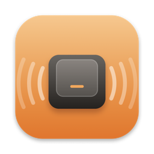

<p align="center"></p>

<h1 align="center">OpenThock</h1>

<p align="center"><b>Satisfying mechanical keyboard sounds for every keystroke on your Mac. Free and open source.</b></p>

<p align="center">
  <a href="https://github.com/wenayy/OpenThock/releases/latest/download/OpenThock.dmg"><b>⬇️ Download OpenThock for macOS</b></a>
  &nbsp;·&nbsp; macOS 14+ · Apple Silicon & Intel
</p>

Every key has its **own** press sound and its **own** release sound, recorded from real
switches, the way [Klack](https://tryklack.com) does it. It ships with Cherry MX Black,
Red, Brown, Blue and Topre, and you can record your own keyboard.

> OpenThock is an independent project. It isn't affiliated with Klack and contains no
> Klack code or audio. If you love Klack's hand-recorded switch sets, buy Klack and
> support its developer.

## Install (1 minute)

1. **[Download OpenThock.dmg](https://github.com/wenayy/OpenThock/releases/latest/download/OpenThock.dmg)** and open it.
2. Drag **OpenThock** into **Applications**.
3. Open it from Applications. The first time, macOS says it "can't verify the developer",
   because OpenThock isn't notarized by Apple (that needs a paid Apple developer account). To open it anyway:
   - **macOS 15+:** click **Done**, then go to *System Settings → Privacy & Security*,
     scroll down, and click **Open Anyway** next to OpenThock.
   - **macOS 14:** right-click OpenThock in Applications → **Open** → **Open**.
   - Or in Terminal: `xattr -dr com.apple.quarantine /Applications/OpenThock.app`
4. The welcome window asks for **Input Monitoring**. Turn on OpenThock in System Settings.
5. Start typing. 🎉

A keyboard icon appears in your menu bar. Click it to pick a switch, change the volume,
tune the sound, or record your own keyboard. Press **⌃⌥K** anywhere to turn it on or off.

**Privacy:** OpenThock has no network code. It never stores or sends your keystrokes;
it only counts them for the stats in the menu.

## Why "per-key" matters

Many keyboard-sound apps pick a random sample from a small pool. Klack doesn't:
`E` always plays E's recording, and releasing it plays E's *release* recording. That's
why it sounds like one real keyboard instead of a slot machine. See
[docs/REVERSE_ENGINEERING.md](docs/REVERSE_ENGINEERING.md) for how this was confirmed
from Klack's public website code: per-key `<code>-down.wav` / `<code>-up.wav` files,
libuiohook key codes, preview timings, and the changelog feature list.

OpenThock uses the same model and the same file naming.

## Features

- **Per-key press + release sounds**, with deterministic same-group fallback for keys a pack lacks
- **Keyboard Recorder**: record your own keyboard key by key from the mic, with automatic onset detection, trimming and pack-wide normalization
- **5 real recorded switch sets** with per-key press and release files: Cherry MX Black, Red, Brown, Blue, and Topre (Mechvibes recordings, MIT; see [SOUNDS-LICENSE.md](SOUNDS-LICENSE.md))
- 3 **procedurally generated** switch sets (Thock / Clack / Clicky), CC0
- **Tone Pad**: X = pitch, Y = per-press variation (small randomized playback rate)
- **Spatial audio**: 2D stereo panning by key position, or 3D (ITD/ILD + head shadow) on headphones; Auto picks for you
- Mouse click, scroll-wheel tick, and optional typewriter **ding on return**
- Modifier-key toggle, function and media keys, numpad
- Ignores synthetic (software-generated) key events
- Output device picker, global toggle **⌃⌥K**, timed sleep, per-app mute
- Keystroke stats
- Low latency: lock-free C real-time mixer with a 256-frame IO buffer
- **Mechvibes pack import** (wav/mp3; same key codes)

## Build from source

Needs macOS 14+ and the Xcode Command Line Tools (Swift 5.9+).

```bash
git clone https://github.com/wenayy/OpenThock.git && cd OpenThock
./scripts/build-app.sh          # → dist/OpenThock.app (universal, ad-hoc signed)
./scripts/make-dmg.sh           # → dist/OpenThock.dmg + .zip
open dist/OpenThock.app
```

Pushing a tag like `v0.2.0` makes GitHub Actions build the DMG and publish a release.

On first run, click **Grant Access…** and enable OpenThock under
*System Settings → Privacy & Security → Input Monitoring*. Ad-hoc builds change
signature each time you rebuild, so you may need to remove and re-add it after a rebuild.

Headless tools:

```bash
swift build
.build/debug/OpenThock --self-test                                  # engine checks
.build/debug/OpenThock --render-demo demo.wav --pack synth-clicky   # hear a pack without permissions
```

## Record your own keyboard

1. Menu bar → **Record Keyboard…** → **Start Listening** (allow the mic).
2. Quiet room, mic close to the keyboard. AirPods mics are poor for this; the built-in mic or a USB mic works better.
3. Press each highlighted key **once, firmly, and hold it about half a second** before releasing, so the press and the release are captured separately.
4. Green = press + release captured, yellow = press only. Click a key to re-record it.
5. **Save Switch Set**. It becomes the active set immediately.

Playback is muted while the recorder is listening, so the speakers don't bleed into the mic.

## Pack format

`~/Library/Application Support/OpenThock/Packs/<pack>/`

```
pack.json          {"name": "...", "author": "...", "license": "CC-BY-4.0",
                    "colors": ["#fff3e6", "#fecf9a"], "gain": 1,
                    "groupGains": {"space": 0.85}}
30-down.wav        A pressed     (libuiohook / PC set-1 code)
30-up.wav          A released
57-down.wav        Space …
mouse-left-down.wav, mouse-left-up.wav, scroll-down.wav, ding.wav   (optional)
```

Key codes are in [`Sources/OpenThock/KeyMap.swift`](Sources/OpenThock/KeyMap.swift).
Common ones: `A=30`, `E=18`, `K=37`, `Space=57`, `Return=28`, `Backspace=14`,
`Left Shift=42`, `Left ⌘=3675`, arrows `57416/57419/57421/57424`.

Please only share packs you recorded yourself or have the rights to.

## Layout

```
Sources/CMixer/          real-time C mixer (lock-free trigger queue, 96 voices)
Sources/OpenThock/
  InputMonitor.swift     CGEventTap: keys, modifiers (L/R), media keys, mouse, scroll
  KeyMap.swift           macOS kVK → Klack/uiohook codes, layout positions, groups
  SoundPack.swift        pack loading, deterministic fallback
  SoundPlayer.swift      tone pad, variation, 2D/3D spatialization
  AudioOutput.swift      AVAudioEngine host, device selection
  Recorder.swift         mic ring buffer, onset detection, pack writer
  Synth.swift            procedural switch sets
docs/REVERSE_ENGINEERING.md
```

## Not yet

Klack's other sleep triggers (Focus, media playing, calendar, screen sharing, games),
AppleScript/Raycast, haptics.

## License

MIT for the code. Bundled recordings: MIT (Hai Nguyen / Mechvibes), see [SOUNDS-LICENSE.md](SOUNDS-LICENSE.md). Synthesized packs: CC0.
